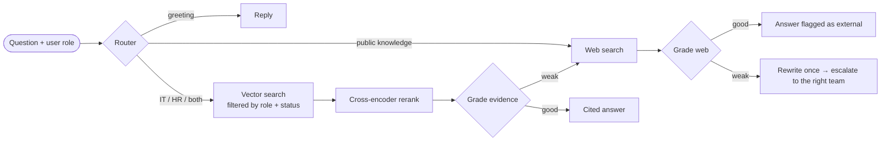

# Enterprise Agentic RAG Copilot


**One assistant for IT and HR questions that cites its sources, respects who is allowed to see what, and says "I don't know" instead of guessing.**

Employees ask questions in plain language. A LangGraph agent decides whether each question belongs to IT, HR, both, or the public web. It retrieves only the documents that user is permitted to read, re-ranks and grades the evidence, and answers with a numbered citation for every fact. When the evidence isn't there, it escalates to the right team.

I measured every change against a 72-question evaluation set:

| | Baseline | Final |
|---|---|---|
| Overall pass rate | 84.8% | **97.2%** |
| Claims supported by sources (LLM judge) | 97.8% | **100%** |
| Answered from the right source (KB / web / declined) | 90.3% | **100%** |
| Required facts present | 88.9% | **97.9%** |

Access control and versioning hold too: **no restricted content reached unauthorized roles** in the 6 access-control tests, and **no outdated or forbidden values** appeared across 8 checks.

<!-- Demo: add a GIF at docs/assets/demo.gif and embed it here -->

---

## Why I built it

Internal knowledge is split across teams. People don't know whether a question is "IT" or "HR", and many real questions are both: *"I'm starting remote work next week. What do I need to set up, and what are the rules?"*

A plain chatbot isn't safe here. It can invent policy, quote last year's benefits, or show salary bands to the wrong person. I wanted to build the version a company could trust, and to **prove** it works with numbers rather than a demo.

## What it does

- **Routes across departments.** Each question goes to IT, HR, both, the public web, or simple conversation. Departments are defined in one registry, so adding Finance is one entry plus a folder of documents.
- **Grounded, cited answers.** Every fact carries a numbered footnote that links to the exact document and section. The agent may not add advice its sources don't contain.
- **Access control inside the vector search.** Employees, managers, HR staff and IT admins see different documents. Restricted chunks are filtered out *in the Pinecone query itself*, so they never reach the model.
- **Document lifecycle.** Superseded policies stay on record but are never retrieved.
- **Grades its own evidence.** The agent reasons about whether the retrieved chunks actually answer the question. If not, it falls back to the web, rewrites the query once, and then escalates.
- **Guardrails.** Uploads containing prompt injection are blocked, injection attempts in questions are flagged, and personal data is redacted from the audit log. Company questions can never be answered with another organization's data.
- **Observable.** Every answer shows its decision trace, per-step timing, latency and token cost.

## How it works



| Layer | Technology |
|---|---|
| Agent | LangGraph state machine, OpenAI `gpt-4o-mini` |
| Retrieval | Pinecone (one namespace per department), OpenAI embeddings, `bge-reranker-v2-m3` re-ranking |
| Web fallback | Tavily |
| API and UI | FastAPI, vanilla JavaScript |
| Data | Section-aware chunking with contextual headers, idempotent ingestion |
| Quality | 72-question golden set, GPT-4.1 faithfulness judge, 32 offline tests |
| Delivery | Docker (multi-stage, non-root), GitHub Actions CI/CD, GHCR |

The full design rationale is in [docs/architecture.md](docs/architecture.md).

## Evaluation: what I learned

I built the evaluation **before** optimizing, then changed one thing at a time:

| Stage | Pass rate | What changed | What the evaluation revealed |
|---|---|---|---|
| Baseline | 84.8% | | The grader rejected good evidence. The agent told an employee they *could* use Dropbox, against the policy it had just retrieved |
| Agent logic | 93.9% | Three-way router, reasoning grader, cited answers | Web fallback presented another company's office details as ours |
| Retrieval | 90.9% | Contextual chunks, re-ranking | Re-ranking was neutral on this corpus, and it surfaced *both* old and new benefits guides |
| Enterprise controls | **97.2%** | Role and status filters in the search, deterministic web guard | A live test showed Amazon's salary bands leaking through the web; a code-level guard closed it |

The biggest lesson: **prompt instructions alone weren't enough** for version conflicts or third-party data. Both needed structural fixes in code. Methodology and caveats are in [docs/evaluation.md](docs/evaluation.md).

## Quick start

You need Python 3.11+ and API keys for OpenAI, Pinecone (free tier) and Tavily (free tier).

```bash
git clone https://github.com/SyedHassamJan/enterprise-agentic-rag-copilot.git
cd enterprise-agentic-rag-copilot
python -m venv venv && venv\Scripts\activate        # macOS/Linux: source venv/bin/activate
pip install -r requirements.txt -r requirements-dev.txt
copy .env.example .env                               # add your keys
python ingest_sample_kb.py                           # index the sample knowledge base
python run.py                                        # http://127.0.0.1:8080
```

Or with Docker:

```bash
docker compose up --build -d
docker compose run --rm app python ingest_sample_kb.py
```

### Try it

| Viewing as | Ask | You'll see |
|---|---|---|
| Alex (employee) | *I'm starting remote work next week. What do I need to set up and what are the rules?* | IT + HR routing, footnotes to both handbooks |
| Alex (employee) | *What is the salary band for an L4 Manager?* | Not answered: restricted |
| Priya (HR staff) | *What is the salary band for an L4 Manager?* | $95,000 to $125,000, cited |
| Alex (employee) | *What is the company's 401(k) match?* | The current policy, never the archived one |

## DevOps

| Pipeline | Trigger | Steps |
|---|---|---|
| **CI** | Every push and pull request | Ruff lint → pytest (Python 3.11 and 3.12) → Docker build + smoke test (health, UI, readiness, non-root) |
| **Release** | Tag `vX.Y.Z` | Build and publish to GitHub Container Registry → deploy hook behind an approval gate |
| **Evaluation** | Manual | Full golden set against the real APIs; fails below a 90% pass rate |
| **Dependabot** | Weekly | Dependency, Actions and base-image updates |

The step-by-step setup is in [docs/devops-guide.md](docs/devops-guide.md).

## Documentation

[Architecture](docs/architecture.md) · [Configuration](docs/configuration.md) · [API](docs/api.md) · [Knowledge base](docs/knowledge-base.md) · [Security](docs/security.md) · [Evaluation](docs/evaluation.md) · [Operations](docs/operations.md) · [DevOps guide](docs/devops-guide.md) · [Changelog](CHANGELOG.md)

## Project structure

```text
app/
  api/routes.py           HTTP API: chat, ingest, users, health, readiness
  core/access.py          roles and the retrieval filter (access control + lifecycle)
  rag/workflow.py         the LangGraph agent
  rag/departments.py      department registry
  rag/vectorstore.py      Pinecone search and idempotent upserts
  rag/rerank.py           cross-encoder re-ranking with fallback
  services/               ingestion, guardrails, audit log
data/sample_kb/           23 IT and HR documents (incl. archived and restricted)
eval/                     golden set, evaluation runner, LLM judge, reports
tests/                    offline test suite (no API keys needed)
docs/                     architecture, security, evaluation, DevOps guide
Dockerfile, docker-compose.yml, .github/workflows/
```

## Roadmap

- Ask a clarifying question when a term is ambiguous (for example "P1").
- Stream answers and decision steps live.
- Tool calling with human approval (create a ticket, check leave balance).
- Real SSO identity in place of the demo user switcher.
- A held-out evaluation split and a hosted demo.

## Author

**Syed Hassam Jan**: [GitHub](https://github.com/SyedHassamJan)

## License

Apache 2.0. See [LICENSE](LICENSE) and [NOTICE](NOTICE). The initial scaffolding was adapted from an Apache-licensed reference project by [Bappy Ahmed](https://github.com/entbappy).
