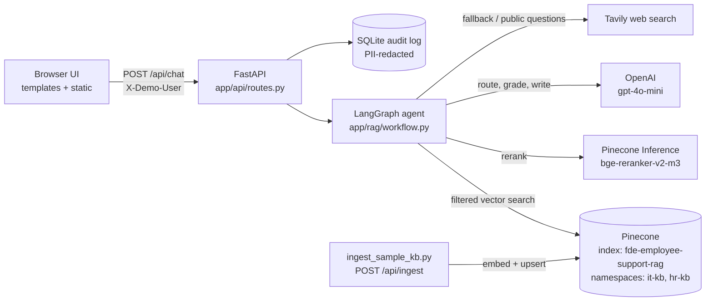
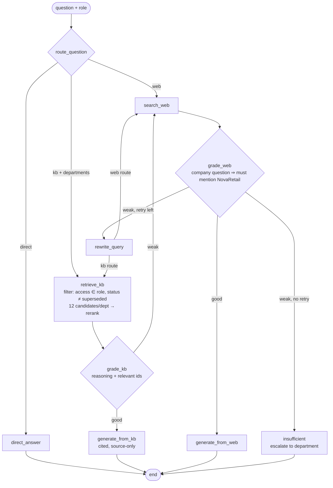

# Architecture

## Components

| Layer | Module | Responsibility |
|---|---|---|
| HTTP | `app/main.py`, `app/api/routes.py` | Pages, JSON API, upload validation, metrics, audit |
| Identity and access | `app/core/access.py` | Demo users, role-to-access-level mapping, the retrieval filter |
| Agent | `app/rag/workflow.py`, `app/rag/state.py` | The decision graph and its typed state |
| Domains | `app/rag/departments.py` | The department registry: topics, namespace, escalation contact |
| Retrieval | `app/rag/vectorstore.py`, `app/rag/rerank.py` | Embeddings, Pinecone search and upserts, cross-encoder re-ranking |
| Ingestion | `app/services/ingestion.py` | Loaders, section-aware chunking, access and status metadata |
| Safety | `app/services/guardrails.py` | Prompt-injection detection, PII redaction |
| Audit | `app/services/audit.py` | SQLite request log with schema migration |

## Decision graph

Every node is wrapped by `timed()`, which appends `{node, ms}` to `state["timings"]`. The API returns those timings, and the UI shows them under "Time per step".

## Request lifecycle (`POST /api/chat`)

1. **Identity.** The `X-Demo-User` header maps to a user and role. Unknown or missing values default to `alex` (employee).
2. **Routing.** The LLM returns structured JSON `{route, departments}`. Unknown department keys are dropped; if none remain, all departments are searched.
3. **Retrieval.** For each selected department, run a similarity search in that department's namespace with the metadata filter from `retrieval_filter(role)`. Candidates from all departments are re-ranked together, keeping `top_k × departments` (at most 8).
4. **Grading.** The LLM states its reasoning, lists the relevant chunk numbers, and grades the evidence. Only the relevant chunks go on to generation.
5. **Generation.** The answer uses only the numbered sources, cites `[n]` after each fact, and may only refer the employee to the department's official contact. Citations return `refs` so the UI can draw footnotes.
6. **Fallback.** On a weak grade, the agent searches the web. For company questions, web evidence must be about NovaRetail (a deterministic check), then it goes through an LLM grade. One query rewrite and retry is allowed, then the agent escalates.
7. **Audit.** The request is logged with user, role, route, departments, latency, tokens and an injection flag, with question and trace PII-redacted.

## Design decisions

| Decision | Alternative considered | Why this one |
|---|---|---|
| A fixed state machine (LangGraph) | An autonomous tool-calling agent | Predictable, testable paths, which policy answers need. The LLM decides *branches*, not *code paths*. |
| One Pinecone index, one namespace per department | One index per department | Cheaper; cross-department search is a loop; adding a department needs no new infrastructure |
| Access control as a vector-search filter | Filtering results after search, or prompt rules | Unauthorized text never reaches the prompt, so prompt injection can't extract it |
| Superseded documents filtered out, still indexed | Deleting old versions, or prompt rules | The evaluation showed prompts leaking old values; keeping them indexed preserves auditability |
| A deterministic web guard | LLM grading only | The LLM grade alone let Amazon and L3Harris salary data through |
| Contextual chunk headers | Plain fixed-size chunks | Retrieval and the re-ranker see the title, section and status |
| Deterministic IDs `sha1(source)#chunk` | Random IDs | Re-ingesting replaces vectors instead of duplicating them |
| Pinecone-hosted re-ranker with a fallback | No re-ranking, or a local cross-encoder | No model download or GPU; if it fails, quality degrades instead of the request failing |
